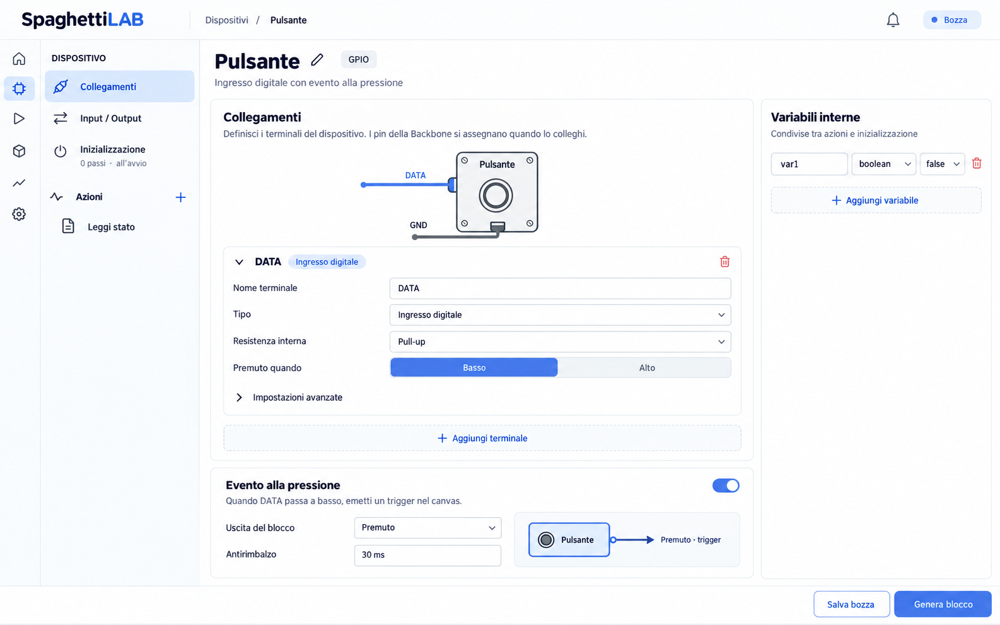

# SpaghettiLAB hardware visual language

Approved by Andrea on 2026-10-17. Use this as the visual reference for future
hardware devices and connectors, including Function Bay V1 and V2.

## Artwork

- Front view; recognizable physical object, rather than a generic software icon.
- Soft dark gray outlines, light neutral surfaces, modest volume, small mounting
  screws when appropriate. Restrained blue for signals, muted warm supply and
  gray ground. Avoid photorealism, neon, heavy shadows or perspective.
- Labels and topology come from the driver, not the illustration. Do not invent
  GPIOs, VCC, GND, relay contacts or load terminals based on the selected object.
- Wires stay continuously connected to a visible terminal at the object edge.
- Shared implementation: `HardwareIllustration.tsx`. It provides devices and
  connector-v1 / connector-v2 artwork. Connector pin orientation, numbering and
  assignments must come from actual connector data when integrating a view.
- This is a device illustration, not a certified circuit/wiring diagram. Shape
  positions are illustrative; terminal names remain authoritative.

## Editor

One window: section navigation at left, selected content in the center, shared
variables only at right. Device details and advanced settings are collapsible.

Connections describe electrical terminals. Input / Output describes canvas
interfaces. Initialization is startup-only; actions are repeatable sequences.
GPIO physical routing belongs to installation on a Backbone and must not eject
users from the driver editor. VCC (3.3 V or 5 V), GND and passive contacts are
metadata, never generated as software-controlled GPIO signals. Supply voltage
is a declaration, not a command that changes hardware voltage.

Changing a device illustration must not replace signals, actions, events or
variables. Templates prepare a new empty driver only. Stable terminal IDs remain
unchanged when the user edits visible labels. Hardware appearance and declared
supply/contact terminals persist with the draft.
