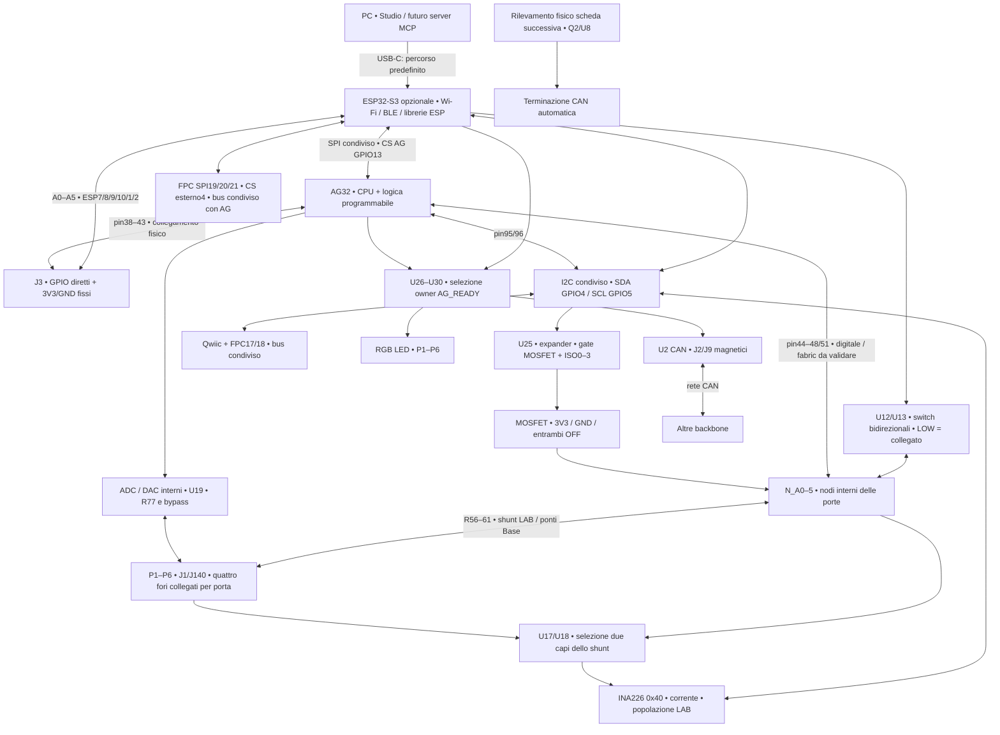

# Backbone — mappa di collegamenti e modalità

Aggiornamento 29 ottobre 2026. Baseline elettrica: `706c39d`. Questo documento descrive lo schema salvato, non un firmware già funzionante. PCB ancora non instradato. Nessuna modifica elettrica in questa revisione documentale.

## Mappa generale

Il segnale `TERM_CTRL` in uscita a U30 è attualmente solo su U30/R106: **non aziona Q2/U8**. Il circuito automatico usa `TERM_CTRL_OUT` da J9. Il comando software della terminazione è quindi riservato e non implementato, anche se alcune note precedenti lo descrivevano come attivo.

## Cosa è disponibile nelle tre combinazioni

| Funzione | Solo ESP32 | Solo AG32 | Entrambi |
|---|---|---|---|
| P1–P6 digitali | Percorso fisico attraverso U12/U13 | Percorso fisico AG → N_A; pin-mux/fabric da validare | Un solo driver per rete; altro controllore input/Hi-Z |
| 3V3/GND sulle porte | U25 e MOSFET | U25 e MOSFET | Owner I2C concordato |
| Corrente LAB | INA + mux accessibili da ESP | INA + mux accessibili da AG | Un owner per canale/calibrazione/conversione |
| ADC/DAC AG interni | Assenti | Collegamenti predisposti | Gestiti da AG; ESP richiede misure via protocollo |
| RGB e CAN | Selettori LOW / ESP | Inizializzare AG, poi AG_READY HIGH | AG prende controllo dopo handshake |
| Qwiic I2C | GPIO4/5 | AG95/96, configurazione da implementare | Stesso bus; accesso coordinato |
| FPC SPI esistente | ESP master | Non qualificato come master AG autonomo | ESP master; AG ed esterno con CS diversi |
| SPI/I2C indipendenti su P1–P6 | Configurazione GPIO ESP prevista | Obiettivo via fabric o pin-mux: da validare | Non guidare gli stessi segnali da entrambi |
| Wi-Fi/BLE e USB-C predefinita | Tramite ESP | Non disponibili su questo percorso senza ESP | Tramite ESP |
| Campionamento/trigger/emulazione FPGA | Assenti | Obiettivo HDL, non implementato | Obiettivo HDL; comunicazione con ESP |

Le indicazioni hardware non certificano driver o blocchi Flow già sviluppati. Chip omesso supportato dal progetto; chip montato ma spento separatamente non isolato dal backpower.

## Pin delle sei porte

A0–A5 sono nomi di rete, non i nomi commerciali delle porte P1–P6. I due lati dello shunt sono distinti. I numeri AG sono pin fisici LQFP100; quelli ESP sono GPIO.

| Porta | GPIO ESP | AG lato ESP/J3 | AG drive N_A | AG ADC lato esterno PORT_A | J1 e J140, stessi pad su entrambi | Gate U25 P/N | Abilitazione percorso ESP |
|---|---|---|---|---|---|---|---|
| P1 | 7 | 38 | 44 | 23 | 1,2 | P00/P01 | P14 / ISO_A0_N |
| P2 | 8 | 39 | 45 | 24 | 3,4 | P02/P03 | P15 / ISO_A1_N |
| P3 | 9 | 40 | 46 | 25 | 5,6 | P04/P05 | P16 / ISO_A2_N |
| P4 | 10 | 41 | 47 | 26 | 7,8 | P06/P07 | P17 / ISO_A3_N |
| P5 | 1 | 42 | 48 | 31 | 9,10 | P10/P11 | U28: ESP39 / AG35 |
| P6 | 2 | 43 | 51 | 32 | 11,12 | P12/P13 | U29: ESP40 / AG36 |

Ogni P ha quattro fori comuni: due su J1 e due su J140. J3 è separato dalle porte quando U12/U13 sono aperti. È comunque collegato ai corrispondenti pin AG38–43: non guidarli contro ESP. Il campionamento digitale su N_A osserva il lato prima dello shunt; ADC AG osserva il lato esterno dopo lo shunt.

### Attivazione di una porta

1. Mettere in input/Hi-Z i driver ESP e AG coinvolti, mantenere DAC scollegato; disabilitare il percorso ESP durante il cambio.
2. Impostare U25 con latch sicuri prima di abilitare le uscite: gate P=HIGH e N=LOW significa entrambi MOSFET OFF. Latch completi iniziali U25: banco0 `0x55`, banco1 `0xF5`; ISO4/5 HIGH. L'indirizzo U25 è `0x20`.
3. Scegliere una modalità dalla tabella e soltanto dopo abilitare l'uscita desiderata.

| Modalità | Gate P | Gate N | ISO_N verso ESP | Driver digitale / DAC |
|---|---|---|---|---|
| Scollegata | HIGH | LOW | HIGH | ESP e AG Hi-Z, DAC isolato |
| 3V3 | LOW | LOW | HIGH | Tutti gli altri driver Hi-Z |
| GND | HIGH | HIGH | HIGH | Tutti gli altri driver Hi-Z |
| GPIO/periferica ESP | HIGH | LOW | LOW | ESP attivo; AG lato A e N input/Hi-Z |
| GPIO/periferica AG/FPGA | HIGH | LOW | HIGH | AG N_A attivo; altri driver Hi-Z |
| Solo osservazione FPGA | Come richiesto dal circuito | Come richiesto dal circuito | Secondo owner | FPGA input, mai uscita concorrente |
| Stimolo DAC AG | HIGH | LOW | HIGH | Driver digitali Hi-Z; scegliere U19 e bypass R77 |

**P=LOW e N=HIGH è vietato:** cortocircuiterebbe 3V3 e GND. U25 non fornisce un interlock hardware né un watchdog. Nessuna modalità di alimentazione esterna fuori dal dominio3V3 è autorizzata da questa tabella. I valori HIGH/LOW non indicano limiti di corrente.

## Due bus esterni separati dai bus interni

Esempio di assegnazione delle sei porte, non un settaggio firmware già salvato:

| P1 | P2 | P3 | P4 | P5 | P6 |
|---|---|---|---|---|---|
| SPI SCLK | SPI MOSI | SPI MISO | SPI CS | I2C SDA | I2C SCL |

- ESP: configurare SPI su GPIO7/8/9/10 e I2C su GPIO1/2; attivare tutti i sei switch verso ESP. SDA/SCL open-drain con pull-up esterni adeguati, spesso presenti sui moduli.
- Solo AG: obiettivo SPI/I2C via fabric sui pin44/45/46/47/48/51; prima verificare raggiungibilità nella toolchain, poi implementare HDL/interfaccia CPU. Il pin-mux nativo non è equivalente alla matrice GPIO ESP. Nessuna frequenza o combinazione è già qualificata.
- In questo esempio tutte le porte sono segnali: alimentazione e massa devono arrivare da altri contatti, ad esempio i rail fissi di J3 secondo pinout, o alimentazione esterna compatibile con massa comune. Non riutilizzare una delle sei come power senza liberarne la funzione bus.
- Separati logicamente dai bus interni non significa isolamento galvanico o banda illimitata. Rimangono switch, shunt e ingressi di misura collegati; velocità e carico da validare.

## Bus interni esposti e pin dei servizi

| Servizio | Pin ESP GPIO | Pin AG fisico | Connettore / attivazione |
|---|---|---|---|
| I2C condiviso | SDA4 / SCL5 | SDA95 / SCL96 | Qwiic3/4 e FPC17/18; un master attivo; INA0x40, U25 0x20 |
| SPI condiviso | CLK14 / MOSI43 / MISO44 | CLK87 / MOSI88 / MISO91 | FPC19/20/21; AG CS=ESP13→AG86; esterno CS=ESP11→FPC4 |
| Owner periferiche | Nessun nuovo GPIO; accordo su SPI | READY52 | LOW ESP, HIGH AG dopo inizializzazione; non è discovery automatico |
| RGB | 21 | 7 | U27; indicazione colori gestita da firmware |
| CAN TX | 17 | 92 | U26 verso U2; inattivo HIGH |
| CAN RX | 18 | 93 | U2 RX comune ai due ingressi |
| ISO P5/P6 | 39/40 | 35/36 | U28/U29; HIGH apre, LOW collega ESP |
| TERM riservato | 38 | 1 | U30→TERM_CTRL; non collegato al relè automatico |
| Mux corrente S0/S1/S2/INH | 6/12/41/42 | 2/3/4/5 | Tutti open-drain; inattivo input; pull-up10k |
| INA ALERT | Polling, nessun pin dedicato | 84 | Registri condivisi; IRQ cablato solo AG |
| DAC RAW / ADC monitor | — | DAC29 / ADC15 | AG interno; R77 verso LIMITED |
| ADC monitor LIMITED | — | 16 | U19 verso una porta; S0/S1/S2/INH AG78/79/80/81 |
| Bypass resistenza R77 | — | 85 | LOW chiude U13C; HIGH mantiene R77 nel percorso |

Per leggere corrente: inibire U17/U18, selezionare0–5, abilitare e attendere assestamento, avviare una nuova conversione INA e aspettare conversion-ready. Non leggere una misura del canale precedente come se fosse del nuovo. La lettura è multiplexata, non simultanea.

Per DAC: driver digitali Hi-Z, MOSFET OFF, U19 inizialmente inibito; impostare un valore noto, canale e bypass, quindi abilitare. R77 limita lo stimolo per scansioni/componenti; il DAC non è una sorgente di alimentazione per sensori. Firmware, tempi di assestamento e misure reali restano da sviluppare.

## FPGA e Flow: possibilità, non funzioni già pronte

- Periferiche digitali configurabili: SPI, I2C open-drain, UART, PWM, contatori.
- Osservazione: catture, trigger e timestamp, con buffering compatibile con risorse effettive e banda di trasferimento.
- Emulazione di una periferica o sensore per backbone; protocolli e timing da implementare, non emulazione universale.
- Registri di configurazione possono selezionare periferiche e routing già presenti in un bitstream; aggiungere logica diversa può richiedere risintesi e caricamento.
- Niente passaggio analogico attraverso la fabric. Un ponte digitale bidirezionale universale non nasce collegando semplicemente due GPIO: SPI richiede direzioni definite, I2C gestione open-drain, altri protocolli logica propria.
- MCP sul PC potrà esporre le catture e i comandi quando firmware, HDL e servizio saranno implementati. Nessun server MCP hardware o acquisizione real-time è stato realizzato da questa documentazione.

## Programmazione e recupero

ESP GPIO47→AG69 UART RX e GPIO48←AG68 UART TX; GPIO15→AG BOOT0/94, GPIO16 open-drain→AG NRST/14. Conservare UART, BOOT, reset e JTAG di recupero; collegamenti predisposti, programmatore via ESP non implementato. R17/R18 collegano USB-C a ESP; R81/R82 sono l'alternativa AG DNP, mai montare entrambi i percorsi contemporaneamente. Vedere `ESP32-AG32-PROGRAMMING.md`.

## Fonti e limiti

Mappa ricavata da `backbone.kicad_sch`, netlist XML e tabelle `bom/lab-v1/AG32-pins.csv`, `J3-pinout.csv`, `fpc-pinout.csv`, `assembly-variants.csv`. [Stato CAD](CURRENT-REVISION.md), [ownership](DUAL-CONTROLLER.md), [corrente e bus](SHARED-INA-EXTERNAL-BUSES.md). Ultima verifica hardware:909 asserzioni,648 pad coerenti, zero errori ERC e262 avvisi;611 rilievi DRC,499 connessioni da instradare. Nessuna qualifica fisica o HDL compilato. Non confondere una possibilità della fabric con una funzione già disponibile nel software.
