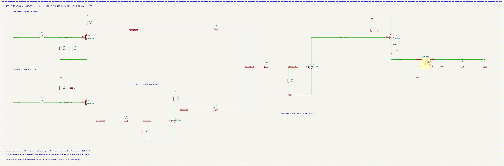
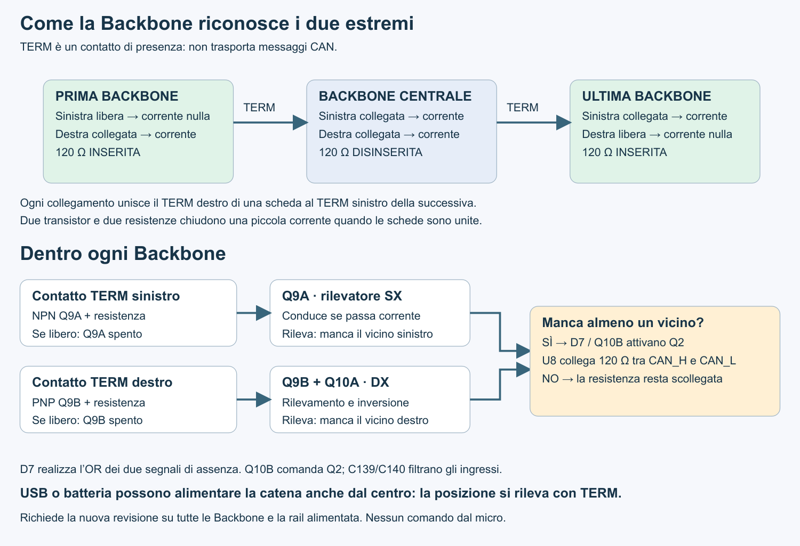

# Terminazione CAN con rilevamento a transistor — 5 novembre 2026

Questa revisione sostituisce il rilevatore LM393 della Backbone. La richiesta è mantenere il riconoscimento automatico dei due estremi senza micro, usando transistor doppi economici e resistenze/condensatori 0603. La mezzanina non viene modificata.

## Componenti

| Rif. | Componente | LCSC | Funzione / contenitore |
|---|---|---|---|
| Q9 | LRC LMBT3946DW1T1G | C136169 | NPN + PNP, SOT-363; rilevamento SX/DX |
| Q10 | LRC LMBT3904DW1T1G | C131781 | Due NPN, SOT-363; inversione DX e comando |
| D7 | JSCJ BAV70 | C68978 | Due diodi a catodo comune, SOT-23; OR |
| R123, R125, R126, R130 | 10 kΩ 1%, UNI-ROYAL 0603WAF1002T5E | C25804 | 0603 |
| R124, R127, R129, R132 | 100 kΩ 1%, UNI-ROYAL 0603WAF1003T5E | C25803 | 0603 |
| R128, R131 | 22 kΩ 1%, UNI-ROYAL 0603WAF2202T5E | C31850 | 0603 |
| C139, C140 | Samsung CL10B103KB8NNNC, 10 nF | C1589 | Filtri base/emettitore, 0603 |

R4 da 10 kΩ, Q2 AO3401A, R5 da 470 Ω, U8 PhotoMOS e R8 da 120 Ω vengono mantenuti. Rimossi U32, R133 e C138; gli altri passivi del precedente rilevatore vengono riutilizzati con le nuove connessioni/valori. Quattro BJT sono contenuti in due package e due diodi in uno: 15 package per il rilevatore, come la revisione precedente, ma con la topologia a transistor richiesta.

I MOSFET AO3401A/AO6604 già presenti non sostituiscono direttamente i BJT di questa rete: il rilevamento sfrutta la corrente di base. Non vengono sottratte funzioni alle porte o alla mezzanina.

Fonti componenti e piedinature:
- [LRC LMBT3946DW1T1G](https://www.lrc.cn/Upload/PDF/Product/SWBJ/LMBT3946DW1T1G.pdf): NPN E1/B2/C6; PNP E4/B5/C3.
- [LRC LMBT3904DW1T1G](https://www.lrc.cn/Upload/PDF/Product/SWBJ/LMBT3904DW1T1G.pdf): NPN E1/B2/C6 e NPN E4/B5/C3.
- [LCSC BAV70 C68978](https://www.lcsc.com/product-detail/C68978.html): anodi 1/2, catodo comune 3.
- [LCSC C136169](https://www.lcsc.com/product-detail/C136169.html), [C131781](https://www.lcsc.com/product-detail/C131781.html), [resistenza 22 kΩ C31850](https://lcsc.com/product-detail/Chip-Resistor-Surface-Mount-UniOhm_22KR-2202-1_C31850.html).

Prezzi: il listino indicizzato di C136169 riportava 0,0134 USD a 600 pezzi e 0,0119 USD a 3.000 pezzi. Per gli altri componenti il preventivo va aggiornato nel carrello. Il precedente budget di 0,03–0,06 USD non è una distinta quotata né include montaggio/IVA; non è dimostrato un risparmio netto sul rilevatore LM393.

## Funzionamento

Il pin 4 destro J9 di una scheda si collega al pin 4 sinistro J2 della successiva. A collegamento presente il percorso è: 5 V → giunzione emettitore/base PNP → 10 kΩ → contatto TERM → 10 kΩ → giunzione base/emettitore NPN → massa. Circola circa 0,18 mA nominale. I resistori base/emettitore definiscono lo stato a contatto aperto; i condensatori da 10 nF filtrano transitori brevi.

Q9A abbassa TERM_ABSENT_L quando il vicino sinistro è presente. Q9B attiva Q10A, che abbassa TERM_ABSENT_R quando il vicino destro è presente. D7 somma i due segnali di assenza; Q10B abbassa il gate Q2 quando manca almeno un vicino.

| SX | DX | Gate Q2 nominale simulato | Resistenza CAN |
|---|---|---:|---|
| Assente | Assente | 0,046 V | Inserita |
| Assente | Presente | 0,049 V | Inserita |
| Presente | Assente | 0,049 V | Inserita |
| Presente | Presente | ≈5 V | Scollegata |

Nessun comando USB, GPIO o firmware è richiesto. Il luogo in cui si immette l'alimentazione non determina la terminazione. Valido a schede alimentate: una scheda realmente spenta non può accendere il proprio PhotoMOS. Ogni collegamento unisce TERM DX a TERM SX; i due contatti non sono una linea comune lungo tutta la catena. J11.48/J11.49 restano disponibili come contatti TERM, da non pilotare o caricare sulla mezzanina.

Tutte le Backbone collegate devono adottare questa revisione: non assumere compatibilità con le precedenti reti TERM. Non si tratta di un rilevatore di verso/polarità del connettore; resta necessaria la chiave meccanica prevista.

## Verifiche e limiti

- Netlist verificata terminale per terminale: modifiche limitate al rilevatore TERM; resto delle connessioni invariato.
- Piedinature dei transistor doppi lette dai disegni ufficiali; libreria di progetto `../libraries/SpaghettiLAB_TERM.kicad_sym` inclusa.
- Nuovi package sul top. Nessuno spostamento degli altri componenti, inclusi quelli bloccati. Scheda ancora non sbrogliata.
- ERC: zero errori, 146 avvisi. DRC: 155 violazioni e 69 discrepanze schematico/PCB preesistenti, senza aggiunte; 456 connessioni da sbrogliare. Non è una dichiarazione di scheda pronta alla produzione.
- Audit completo di footprint: 86 resistenze/condensatori tutti 0603, sia nello schematico sia nel PCB. L1 resta induttore di potenza 3,3 µH in package 4×4 mm: non ridotto a 0603 perché non è una sostituzione equivalente per corrente, saturazione e perdite. L'audit dei formati non certifica tutti i rating elettrici della Backbone.
- ngspice: quattro casi nominali e 108 casi DC con alimentazione 4/5/5,5 V, temperatura −20/25/70 °C, beta 20/100/300, tolleranze resistive campionate ±1,5% e correnti di perdita imposte di 1 µA. Gate acceso massimo 0,063 V; |VGS| nello stato spento massimo 0,0102 V.
- Transitorio di collegamento/scollegamento destro, con sinistro presente: corretta stabilizzazione nei due stati.
- Modelli SPICE generici BJT/diodo, non modelli qualificati dei produttori. Verifica non esaustiva; la prova non comprende un modello completo del PhotoMOS, transceiver, rimbalzi reali dei contatti, ESD, alimentazioni indipendenti con dislivelli di massa o avvio reale. I 10 nF filtrano, ma non implementano isteresi Schmitt. Questi aspetti richiedono prove sul prototipo.

Evidenze riproducibili: `bom/can-term-transistors-20261105/` contiene distinta, audit 0603, verifica, script e risultati di simulazione.
