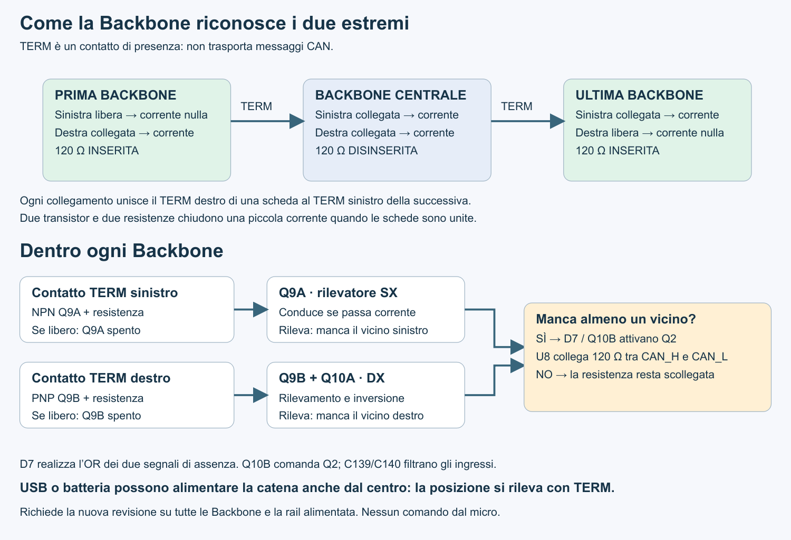

> **Revisione corrente, 5 novembre 2026:** il rilevatore TERM usa Q9/Q10 e D7, senza LM393. Vedere [rete a transistor](CAN-TERM-TRANSISTORS-20261105.md). Le descrizioni precedenti del comparatore sono storiche. Pin dei connettori invariati; serve la stessa revisione su tutte le schede.

# Terminazione CAN automatica ai due estremi — 5 novembre 2026

Implementazione CAD richiesta dall'utente: ciascuna Backbone riconosce i vicini tramite i contatti TERM, indipendentemente da ESP32, AG32 e dalla posizione della sorgente USB/batteria. Progetto non ancora sbrogliato né qualificato sul banco.

## Funzionamento e compatibilità

| Vicino sinistro | Vicino destro | 120 ohm locale |
|---|---|---|
| Assente | Presente | Inserita |
| Presente | Presente | Disinserita |
| Presente | Assente | Inserita |
| Assente | Assente | Inserita (una sola scheda, non un bus completo) |

Tutte le schede devono adottare questa revisione. La vecchia J2.4 direttamente a 5V non è compatibile. I contatti TERM non sono un bus condiviso: J9.4 di una scheda incontra soltanto J2.4 della successiva. Non collegare TERM sinistro e destro sulla stessa scheda. Il sistema presuppone una catena lineare, non anelli o diramazioni. Serve alimentazione locale 4,0–5,5V: l'assenza del processore è ammessa, l'assenza della rail non garantisce la terminazione.

J11.48 conserva il nome TERM_CTRL_IN ma ora espone il contatto analogico sinistro. J11.49 TERM_CTRL_OUT espone quello destro. Le mezzanine devono lasciarli liberi o usare un ingresso opportunamente isolato ad alta impedenza, senza pull-up/pull-down o uscite attive. Non sono GPIO a 3,3V. Nella netlist della mezzanina di esempio letta il 5 novembre i due nodi hanno soltanto i contatti J11.48/49; nessuna modifica al suo CAD.

## Circuito implementato

- R123 10k: TERM_CTRL_IN verso GND; R124 10k: 5V verso TERM_CTRL_OUT.
- R125/R126 e R127/R128: 20k/10k, attenuano ciascun contatto verso TERM_SENSE_L/R.
- R129/R130/R131: 130k/20k/10k in serie tra 5V e GND, generano TERM_REF_H e TERM_REF_L.
- U32 LM393DR (TI, C67470): pin 3 = SENSE_L, pin 2 = REF_L; pin 5 = REF_H, pin 6 = SENSE_R. Pin 1 e 7 open-collector uniti su TERM_GATE_N. Pin 8 = 5V, pin 4 = GND.
- R4 ora 10k da TERM_GATE_N a 5V. Il gate Q2 è separato dal contatto TERM_CTRL_OUT. Gate basso inserisce la terminazione attraverso Q2 e U8 già presenti.
- R132 470k da gate a SENSE_L e R133 1M da gate a REF_H introducono feedback positivo. C139/C140 10nF filtrano gli ingressi; C138 100nF disaccoppia U32.
- R5 passa da 1k a 470 ohm: a 4V, assumendo Vf LED 1,4V e 50mV di margine sul MOSFET, la corrente è circa 5,37mA con R al +1%. A 5,5V/Vf=1,1V è circa 9,46mA. Il relè richiede 5mA nelle condizioni raccomandate; il vecchio 1k non copriva il limite inferiore. Qualificare temperatura e transitori sul banco.

Senza feedback, a 5V i segnali attenuati sono 0V (sinistra libera), 1,25V (destra libera), 0,625V (vicino presente), con soglie 0,3125/0,9375V. Il feedback modifica questi valori: i risultati nodali completi sono nel rapporto elettrico, non usare i valori ideali come punti di collaudo esatti.

## Rimozioni e perimetro

Rimosso NT1, che univa TERM_CTRL_IN a 5V, con i relativi collegamenti superflui. Eliminato il vecchio pull-down di R4 e il comando diretto del gate dal vicino destro. Nessuna rete aggiuntiva USB/GPIO era montata nella baseline: quelle alternative erano soltanto proposte. Q2, U8 e R8 120 ohm restano necessari e sono conservati. Nessun GPIO, servizio, circuito di misura o protezione di alimentazione è stato rimosso.

## PCB e sbroglio

15 nuovi componenti, tutti sul top: U32, R123–R133, C138–C140. Conservati tutti i componenti bloccati. Spostati solo R40, R41, TP15, U25, C129, R113 e R114 per ricavare spazio. Il comparatore è a sinistra del modulo ESP, fuori dal suo keepout antenna; parte dei passivi occupa spazio disponibile sotto il modulo. Verificare comunque altezza e accessibilità nel montaggio reale.

Le sette reti di rilevamento/gate usano TERM_5V, pista 0,20mm. Sono segnali a bassa corrente, non distribuzione di potenza: prevedere budget 3mA per il rilevatore e fino a 10mA aggiuntivi per il LED di U8 quando la terminazione è inserita. Il tratto R8/U8 del CAN resta nella classe CAN_BUS. Nessuna pista/via aggiunta: le posizioni distribuite dei passivi richiedono percorsi corti ragionevoli, ritorno GND continuo e distanza dal nodo switching del buck; mantenere C138 vicino all'alimentazione U32 e i filtri sugli ingressi. Il layout non è una qualifica EMI.

## Verifiche e limiti

- Confronto completo netlist: fra i pin esistenti cambiano soltanto J2.4, Q2.1 e R4.1/2; NT1 eliminato. Tutti i nuovi pin corrispondono al circuito descritto.
- ERC: 0 errori, 140 avvisi (prima 143). Sono ancora presenti avvisi preesistenti; non si dichiara schematico privo di avvisi.
- DRC: 155 violazioni fisiche e 69 rilievi di parità, invariati per tipo e oggetti. Nessuna nuova violazione fisica o parità. 457 connessioni non sbrogliate.
- 3.000 casi nodali DC riproducibili su catene da 1/2/3/4/6 schede: resistenze ±1,5% (incluso budget di deriva), rail indipendenti 4–5,5V, differenza GND adiacente fino a 50mV, bias ingressi ±400nA, offset ±9mV, uscita bassa fino a 0,7V. Anche stati di uscita inizialmente errati inclusi. Margine minimo campionato circa 129mV. Non è una prova esaustiva di tutti i corner né una simulazione SPICE dei dispositivi.
- LM393DR scelto: temperatura nominale 0–70°C. Non attribuire a questo componente il campo esteso della variante LM393B.
- Da provare: rampe di alimentazione, inserzione/disconnessione e rimbalzo dei contatti, tempo di assestamento del PhotoMOS, rumore/EMI e comunicazione CAN alla velocità richiesta. Durante l'aggancio non è garantita comunicazione senza errori. La revisione non aggiunge protezione da inversione, cortocircuito o selezione di sorgenti 5V concorrenti.

## Distinta e fonti

[Componenti aggiunti/modificati](bom/can-termination-20261105/components.csv), [verifica CAD](bom/can-termination-20261105/verification.json), [analisi elettrica](bom/can-termination-20261105/electrical-verification.json). Il solo LM393DR era indicativamente 0,041–0,044 USD a quantità 1000 secondo listini indicizzati; non è il totale del circuito o una quotazione corrente garantita. Il circuito aggiunge anche 11 resistenze e 3 condensatori, più il montaggio; R4/R5 sono sostituzioni.

- [TI LM393, datasheet e pinout](https://www.ti.com/lit/ds/symlink/lm393.pdf).
- [Omron, famiglia G3VM-61VY3](https://components.omron.com/sg-en/datasheet_pdf/K282-E1.pdf).
- [LM393DR C67470 LCSC](https://www.lcsc.com/product-detail/C67470.html).

La posizione della batteria non decide la terminazione. La sua immissione sulla rail 5V richiede comunque la corretta gestione dell'alimentazione: questa modifica riguarda soltanto TERM.

## Schema TERM con fili visibili — 5 novembre 2026

Applicato su richiesta il ridisegno del blocco di terminazione: comparatori U32, rete resistiva, filtri e comando Q2/U8 sono riuniti con collegamenti espliciti. Nessuna modifica elettrica: confronto delle netlist prima/dopo identico per tutti i terminali. PCB e distinta invariati. ERC del ridisegno: zero errori, 142 avvisi (prima 140); la differenza riguarda le etichette globali, senza nuovi avvisi di fuori griglia. Non è una qualifica fisica del circuito.

[Schema elettrico PNG](CAN-TERM-WIRED.png) · [Schema elettrico SVG](CAN-TERM-WIRED.svg)
