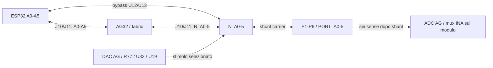

# Mezzanina AG32-LAB — revisione schematica 31 ottobre 2026

**Stato aggiornato: schematici e disposizione dei due PCB aggiornati, nessuno sbroglio. Vedere [layout mezzanina](MEZZANINE-LAYOUT.md).** Il progetto carrier e la nuova scheda modulo sono due progetti elettrici separati; i contatti J10/J11 si accoppiano 1:1. La ripartizione elettrica seguente è quella del primo passaggio schematico. Il passaggio PCB successivo è documentato in MEZZANINE-LAYOUT.md e prevale sui riferimenti meccanici ancora pendenti riportati qui sotto.

## Ripartizione

| Carrier | Mezzanina AG32-LAB |
|---|---|
| FlexyPin ESP32, J1/J140/J3 e connettori magnetici | AG32VF407VGT6 e clock X1 |
| Alimentazione 5V/3V3 e USB-C | ADC e DAC interni AG32, ingressi delle sei porte |
| MOSFET Q3–Q8, buffer/switch U12/U13 | INA226 U16 e mux corrente U17/U18 |
| Sei shunt R56–R61 da0,1Ω sempre montati | Mux DAC U19, R77, bypass U32 e passivi di misura |
| U25 per gate e ISO0–3: necessario per funzionare senza modulo | Programmazione/boot/reset, JTAG e relativi passivi |
| CAN U2 e terminazione automatica Q2/U8 | Flat J5 da24 pin e AUX J12 da24 pin |
| LED RGB e selettori CAN/RGB/ISO4–5 U26–U29 | R109 per priorità modulo e R116 per presenza |
| Nuovo USB switch U31 e rilevamento VBUS | Connessioni per osservazione dei GPIO ESP |

“Solo resistori, buffer e MOSFET” riguarda il blocco porte/misure: la carrier mantiene anche alimentazione e servizi fisici, inclusi expander e selettori, necessari per una base autonoma. La misura non è disponibile senza mezzanina, perché INA/mux/ADC/DAC sono sul modulo. I sei shunt restano da0,1Ω anche nelle carrier base, così l'aggiunta del modulo non richiede dissaldare ponti0Ω.

Non sono stati reintrodotti ADC/DAC esterni più costosi: restano i convertitori interni AG32 già scelti. Frequenza, precisione, rumore e calibrazione non sono stati qualificati da questa revisione.

## Percorso delle sei porte e FPGA

- **Nessun modulo:** ESP32 rimane collegabile alle porte attraverso i sei switch bidirezionali esistenti. Il firmware base inizializza U25 e abilita gli ISO desiderati. Non serve un ponticello sulla mezzanina per chiudere il percorso. Al reset gli ISO rimangono aperti e i MOSFET OFF: non si promette passaggio dei segnali prima dell'inizializzazione.
- **Modulo presente, bypass:** ESP guida attraverso U12/U13; AG resta input/Hi-Z e può osservare, se il mapping della fabric lo consente.
- **Modulo presente, inline:** aprire tutti gli ISO coinvolti; AG usa A0–A5 sul lato ESP e N_A0–5 sul lato porte, implementando il collegamento o la trasformazione digitale in HDL. Nessun percorso elettrico diretto è obbligato ad attraversare silicio digitale: il bypass serve per analogico e modalità base.
- **Solo AG:** ESP assente, ISO aperti, AG guida N_A e legge PORT_A. CAN/USB vanno al modulo per la selezione hardware descritta sotto.

La connessione fisica ai pin AG è implementata. **Raggiungibilità dalla fabric, bridge, periferiche SPI/I2C e campionamento richiedono ancora toolchain/HDL e prove reali.** Un ponte GPIO bidirezionale universale non nasce da una semplice assegnazione combinatoria: SPI ha direzioni definite; I2C richiede open-drain e gestione del ritorno; analogico non passa nella fabric. Nessuna promessa di tutti i protocolli simultaneamente su tutti i GPIO.

Gli ingressi `OBS_*` aggiunti sono collegamenti di osservazione di altri segnali ESP; devono restare input/Hi-Z, non contendere CAN, LED, chip-select, boot o reset. D+/D− USB non sono sonde digitali e non sono collegati a questi ingressi.

| Porta | ESP GPIO | AG lato ESP | AG lato N_A | AG ADC PORT_A |
|---|---|---|---|---|
| P1 | 7 | 38 | 44 | 23 |
| P2 | 8 | 39 | 45 | 24 |
| P3 | 9 | 40 | 46 | 25 |
| P4 | 10 | 41 | 47 | 26 |
| P5 | 1 | 42 | 48 | 31 |
| P6 | 2 | 43 | 51 | 32 |

Numeri AG fisici LQFP100; GPIO ESP, non numeri di pad WROOM. P1–P6 non sono nomi di GPIO fissi quando il bypass è aperto. Lo shunt separa il nodo digitale N_A dal punto esterno PORT_A: campionamento digitale e misura analogica non sono lo stesso punto fisico.

## Presenza, selezione CAN e USB

| Configurazione alimentata | MEZZ_OWNER | USB | CAN TX / RGB / ISO4-5 |
|---|---|---|---|
| Solo ESP32 / modulo assente | LOW da R103 | ESP | ESP |
| Modulo AG32 presente, ESP assente | HIGH da R109 | AG | AG |
| Entrambi presenti | HIGH da R109 | Priorità AG | Priorità AG |
| Modulo presente, ritorno esplicito a ESP | AG52 open-drain LOW | ESP, con distacco USB e nuova enumerazione | ESP, a traffico fermo |

`MEZZ_OWNER` sostituisce il precedente AG_READY: **non significa più “AG inizializzato”**. R103100k verso massa è sulla carrier; R10910k verso3V3 è sul modulo. Il modulo inserito porta nominalmente il selettore a circa3,0V senza bisogno di un handshake per scegliere il percorso. AG52 può solo rilasciare o tirare LOW; deve essere configurato input/open-drain. Questo meccanismo non rileva un AG guasto né ne verifica il firmware.

Un rilevamento separato `MEZZ_PRESENT_N` usa ESP GPIO38 (vecchio ESP_TERM_CTRL liberato), pull-up R115 sulla carrier e ponte R116 a GND sul modulo. HIGH=assente, LOW=presente. Non usare GPIO38 come uscita quando R116 è montato. Un futuro modulo passivo può dichiarare presenza con R116 senza montare il pull-up di claim R109: i servizi resteranno a ESP.

CAN: U26 seleziona il TX verso il transceiver; RX è comune a ESP GPIO18 e AG93. Il CAN è gestito dal controller del micro AG32, anche quando la fabric genera dati: non è stato realizzato un controller CAN HDL. TX di reset rimane recessivo con il bias esistente. Terminazione magnetica Q2/U8 invariata e autonoma; il vecchio selettore U30 e R106, che non comandavano la terminazione, sono stati rimossi.

USB: U31 **TI TS3USB221ARSER, LCSC C128396**, scambia la coppia D+/D−. Pinout verificato sul datasheet TI: 1/2 ramo ESP,3/4 ramo AG,8/7 coppia comune,9 selezione,6 OE_N a GND,10=3V3,5=GND. R17/R18 restano nel ramo ESP; R81/R82 sono ora montati nel ramo AG. Non restano due percorsi passivi USB in parallelo. AG legge VBUS diviso su pin53 attraverso R110/R111; firmware USB deve scollegare il pull-up quando VBUS manca. Pin-mux/periferica USB AG e reset devono essere verificati nel firmware.

Il mux supporta USB2.0; **non trasforma i controller USB Full Speed della scheda in High Speed**. Il cambio owner con host connesso richiede disconnessione logica, pausa e nuova enumerazione. USB non è un hub: un solo dispositivo alla volta. Prezzo aggiornato del mux non ricavato dalla pagina LCSC consultata; non viene dichiarato un costo inventato.

## Misura di tensione, corrente e DAC

- Ogni PORT_A dopo lo shunt attraversa l'interfaccia e arriva all'ADC AG come prima. Per V(a)−V(b) servono le letture dei due punti e differenza software; la scansione non è simultanea e non è una sonda differenziale isolata.
- U17 e U18 sul modulo selezionano rispettivamente N_A e PORT_A della stessa porta per INA226. Tutti i sei capi prima/dopo gli shunt sono portati attraverso J10/J11. La lettura corrente è multiplexata; inibire, selezionare, assestare e avviare una conversione nuova.
- INA rimane sullo I2C condiviso IO4/IO5, quindi anche ESP può configurarlo quando il modulo è montato. Mux S0/S1/S2/INHIBIT rimangono condivisi open-drain, un owner per calibrazione, canale e conversione.
- DAC29→RAW→R77→LIMITED→U19→uno dei sei N_A. Il bypass attivo LOW di R77 è ora U32 sul modulo (SN74LVC1G3157, C38663); U13C sulla carrier è disabilitato, dati NC. RAW/LIMITED non fanno un viaggio inutile sulla carrier.
- Per stimolo DAC: MOSFET OFF, driver digitali input/Hi-Z e ISO ESP aperti; impostare tensione e selezione prima di abilitare. Nessuna garanzia di erogazione di corrente per alimentare sensori dal DAC.

## Interfaccia 120 contatti ed espansione

Proposta elettrica con **due coppie BergStak0,8mm da60 contatti**: carrier femmine61082-061402LF / C254696, modulo maschi61083-061402LF / C464610. Preferenza precedente per una famiglia con più cicli del DF40 conservata; accoppiamento, durata esatta del suffisso, footprint, altezza, keepout, fissaggi e posizione devono essere verificati sul disegno produttore prima del layout. I simboli sono elettrici generici a60 contatti con MPN assegnato: **non sono impronte meccaniche già validate**.

Il contratto `interface-pinout.csv` contiene57 reti di segnale, contatti distribuiti5V/3V3/GND e contatti NC riservati. Non sono120 GPIO liberi. Non trasferire600mA o correnti arbitrarie su un singolo contatto senza verificare rating e corrente aggregata. Stessi numeri di contatto accoppiati1:1; vista e orientamento meccanico devono essere verificati prima di sbrogliare.

Il flat J5 esistente da24 contatti è sul modulo. J12 AUX da24 contatti espone i segnali ESP non già sul flat. `module-expansion-pinout.csv` riporta entrambi; `esp-observation-pinout.csv` elenca gli ingressi AG aggiuntivi di osservazione. Tutti i segnali ESP non USB raggiungono l'interfaccia; molti sono condivisi con servizi e non sono liberi da vincoli. GPIO35/36/37 attraversano ponti R112/R113/R114 **DNP**: non montarli sulle varianti ESP con PSRAM octal che impegnano quei GPIO. GPIO45/46 e BOOT mantengono vincoli di strap; pin UART/boot/reset e servizi condivisi non sono espansione generica da pilotare liberamente.

Moduli futuri possono riusare la stessa interfaccia per connettori, elaborazione o strumenti, con il proprio contratto di alimentazione e claim. La compatibilità non rende automaticamente esistente un modulo oscilloscopio o un sistema di misura veloce.

## Avvio e limiti

1. Inserire/rimuovere il modulo **a scheda spenta**. Non è progettato hot-swap e nessun isolamento è garantito verso un chip montato ma spento.
2. Determinare presenza e owner. Un solo master I2C attivo; inattivo rilascia SDA/SCL e comandi mux. Anche con selezione CAN/USB hardware, l'accesso concorrente a U25 e INA va coordinato.
3. Impostare gate P=HIGH, N=LOW e ISO=HIGH prima di abilitare uscite U25. Selettori ISO4/5 devono avere valori sicuri su entrambe le sorgenti. Mai P LOW e N HIGH contemporaneamente.
4. Senza modulo, firmware ESP abilita i bypass desiderati. Con modulo, prima di usare inline FPGA aprire i bypass e verificare che gli altri driver siano Hi-Z.
5. Configurare USB e CAN dopo alimentazione/clock; i collegamenti non sostituiscono stack USB, firmware CAN o bitstream.

Schematici KiCad: `backbone.kicad_sch` (carrier), `mezzanine/ag32-lab/ag32-lab.kicad_sch` (modulo). PDF in `bom/mezzanine-v1/`. Nel modulo è creato il progetto autonomo `ag32-lab.kicad_pro`; nessuna PCB del modulo è stata creata. Anche il layout carrier esistente è deliberatamente ancora quello precedente.

## Verifiche e fonti

733 confronti net/pin e contatti accoppiati passati; tutti i nodi originali controllati con le modifiche intenzionali esplicite. ERC finale: carrier zero errori/201avvisi; modulo zero errori/77avvisi. Gli avvisi includono librerie legacy, etichette e griglia: non è un sign-off di produzione. Nessun DRC meccanico aggiornato perché il PCB non è stato modificato; nessun HDL compilato o test hardware eseguito. Footprint U31 e connettori mezzanina ancora da validare/assegnare. Vecchie BOM e mappe lab-v1 sono storiche e non descrivono più la ripartizione attiva.

Fonti consultate31ottobre2026: [TI TS3USB221A](https://www.ti.com/lit/ds/symlink/ts3usb221a.pdf), [LCSC C128396](https://www.lcsc.com/product-detail/C128396.html), [BergStak C254696](https://www.lcsc.com/product-detail/C254696.html), [coppia Amphenol](https://www.tti.com/content/dam/ttiinc/manufacturers/amphenol/icc/products/pdf/amphenol_icc_basics.pdf). Associazioni funzionali e pin verificati anche contro la netlist precedente e i due schematici esportati. Nessun plugin specializzato per schemi a blocchi era disponibile: il diagramma è fornito in Mermaid e SVG modificabile.
