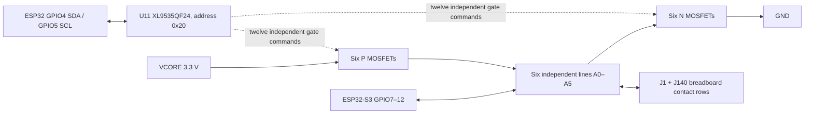

# Current sourcing revision

Q3–Q8 use TECH PUBLIC AO6604 C5182068; U11 uses XINLUDA XL9535QF24 C5444301. These supersede the earlier AOS/TI selections. See ../libraries/LCSC-PORTS.md for electrical compatibility, active footprint/model links and stock/price snapshots. Existing GPIO/3V3/GND circuit and pin connectivity are unchanged.

# Backbone V3 — six base universal ports

Implemented scope: GPIO / 3.3 V / GND only. Current and voltage sensing, shunts, dedicated fast ADC inputs and DAC are postponed by user instruction. No PCB changes or firmware implementation in this revision.

## Wiring and contact assignment

Layout update requested by user: local port, gate and connector connections remain physical wires. Long A0–A5 and SDA/SCL runs now use existing global net names; remote power feeders use local VCORE/GND power symbols. Upper P-channel devices face left, with short direct gate connections. Existing MCU/J3/Qwiic/FPC connections are retained. Sheet enlarged from A2 to A1 to fit the wired circuit; Q3–Q8 and connector row units are on the right.

| Logical line | ESP32 GPIO | Module pad | J1 contacts | J140 contacts | MOSFET | U11 output P / N |
|---|---:|---:|---|---|---|---|
| A0 | 7 | 7 | 1,2 | 1,2 | Q3 | P00 / P01 |
| A1 | 8 | 12 | 3,4 | 3,4 | Q4 | P02 / P03 |
| A2 | 9 | 17 | 5,6 | 5,6 | Q5 | P04 / P05 |
| A3 | 10 | 18 | 7,8 | 7,8 | Q6 | P06 / P07 |
| A4 | 11 | 19 | 9,10 | 9,10 | Q7 | P10 / P11 |
| A5 | 12 | 20 | 11,12 | 11,12 | Q8 | P12 / P13 |

The four contacts in each table row share one electrical line. Different rows remain isolated. J3's original A0–A5 contacts remain on these same nets; they therefore also see a selected supply/ground level. A6/A7 (GPIO13/14) remain unchanged and receive no MOSFET circuit.

J1 and J140 remain the original Harwin M20-7810645R 12-contact physical parts, represented as six 2-contact schematic units each. No new physical connector added.

## Components added

- Q3–Q8: AO6604, six complementary P+N MOSFET packages. Unit A=P (G3,S2,D4); unit B=N (G1,S5,D6).
- R38–R49: 100k gate-source default-off pulls, six P pull-ups and six N pull-downs, 0603.
- U11: one XL9535QF24, represented as six output-pair units A–F plus common unit G. VQFN-24 exposed-pad 4x4 mm; EPAD to GND. A0/A1/A2 to GND, I2C address 0x20.
- C87: 100nF bypass capacitor, 0603.
- SDA/SCL wired to existing GPIO4/GPIO5; existing R24/R25 4.7k pull-ups reused.
- No INA, DAC, current shunts, ADC mux or new dedicated ADC GPIO wiring.

AO6604 local footprint uses standard KiCad SOT-23-6 lands with manufacturer-specific part name; 0.95mm pitch and numbering verified against the TSOP6 drawing. Original physical connector footprints retained.

## Required firmware behavior (not yet implemented)

| Mode | P gate | N gate | ESP32 GPIO |
|---|---:|---:|---|
| GPIO | 1 | 0 | Selected input/output function |
| 3.3 V | 0 | 0 | Input, no pulls |
| GND | 1 | 1 | Input, no pulls |
| High impedance | 1 | 0 | Input, no pulls |
| Forbidden combination | 0 | 1 | Would connect supply to ground |

Before enabling U11 outputs, write Output Port 0 register 0x02 = 0x55, and Output Port 1 register 0x03 = 0x05. Then Configuration Port 0 register 0x06 = 0x00; Configuration Port 1 register 0x07 = 0x00 (four unused outputs are driven low, avoiding floating inputs). This initializes P off / N off. At reset, external gate pulls hold MOSFETs off while the expander outputs are inputs.

For every mode change: stop the GPIO peripheral, disable GPIO output and pulls, set both MOSFETs off, then enable the requested source; only re-enable GPIO output in GPIO mode. Do not change between supply and ground in one unsafe register sequence. No hardware current limiter/interlock is added.

Operating assumption: powered ESP32, common ground, external port signals constrained to 0–3.3 V. This is switched connection, not galvanic isolation. Connector/regulator/PCB current capability requires completed physical design; 600mA remains the shared design budget, not six independent 600mA supplies.

## Deferred fast ADC pin audit

No free independent set of six ADC inputs exists in the saved assignment. ADC-capable GPIO1–20 are currently used by: GPIO1/2/6 FPC; GPIO3 FPC auxiliary strap; GPIO4/5 Qwiic/FPC I2C; GPIO7–14 A0–A7; GPIO15 FPC clock; GPIO16 LED; GPIO17/18 FPC; GPIO19/20 USB. Reserving GPIO1–6 on ADC1 would require reassignment of those functions and has NOT been done. No new ADC pin reservations are claimed.

## Verification

KiCad netlist comparison: all original connected-pin sets preserved; A0–A5 each gain exactly the expected MOSFET drains and four connector contacts. A6/A7 unchanged. Manufacturer pin map checked. Installed-project ERC: 109 findings before (13 errors, 96 warnings), 101 after (7 errors, 94 warnings). No increase in any diagnostic category; fewer dangling old connector wires and symbol mismatches. Pre-existing project diagnostics remain; this is not fabrication clearance.

Sources:
- https://www.aosmd.com/res/data_sheets/AO6604.pdf
- https://www.ti.com/lit/ds/symlink/tca9535.pdf
- https://documentation.espressif.com/esp32-s3-wroom-1_wroom-1u_datasheet_en.pdf

## Layout refinement

Mirrored the remaining five upper MOSFETs to match the first port already edited by the user. Replaced long A0–A5, IO4/IO5 and supply feeder wires with labels/power symbols. Confirmed A0–A5 contact mapping, including A5 continuity to GPIO12. No new components or PCB changes. Backup before layout refinement is in the task outputs directory.
